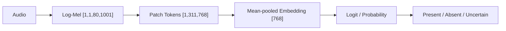
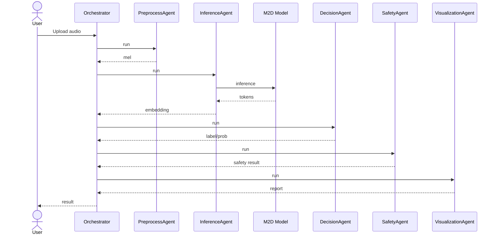

# Multi-Agent Heart Sound Detector

A multi-agent heart sound detector using the **Eheart_sound_by_Ahsan_Mandhar.onnx** model (M2D embedding) with a linear probe.

## Model
- **Model file:** `Eheart_sound_by_Ahsan_Mandhar.onnx`
- **Type:** M2D (Masked Modeling Duo) audio embedding model
- **Precision:** INT8 (ONNX)
- **Input:** `[1, 1, 80, 1001]` log-mel spectrogram
- **Output:** `[1, 311, 768]` embeddings → 768-dim pooled vector
- **Classifier:** Linear probe (`probe.json`)

## Features
- Multi-agent pipeline (preprocess → inference → decision → safety → visualization)
- Local model caching
- Download progress display
- Audio analysis with waveform and mel views
- Decision-support output with abstention

## Architecture Overview

### Model Pipeline Flow

### Agent Interaction Sequence

## License
All rights reserved. No permission is granted to copy, reproduce, distribute, modify, or use this software, model, or associated files without prior written permission.

## Contact
Email: ahsanmandhar@gmail.com