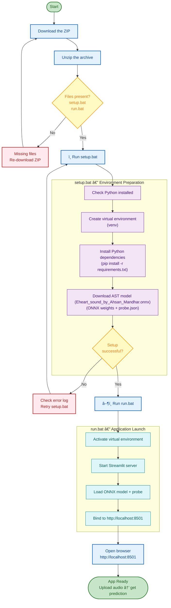
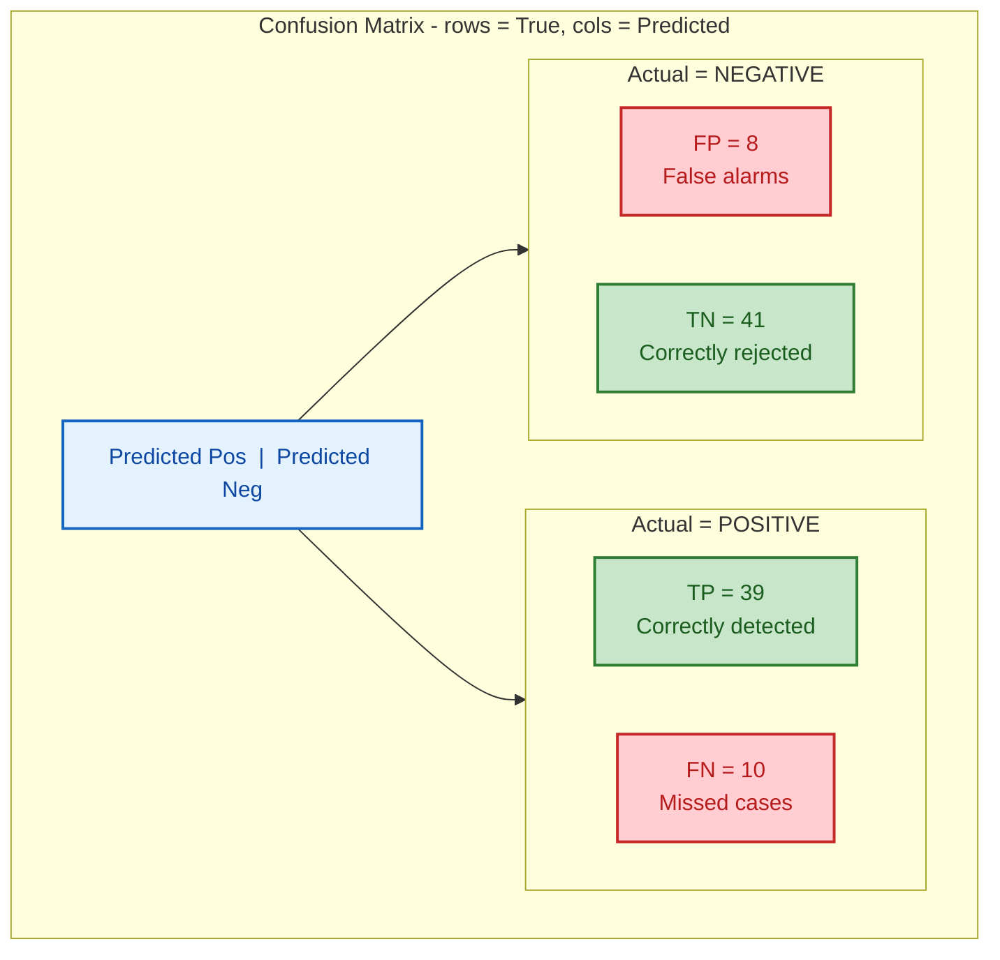
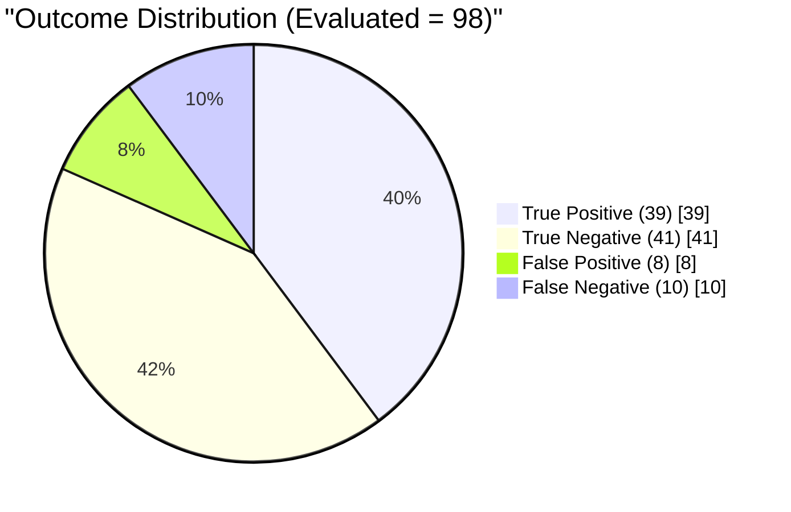
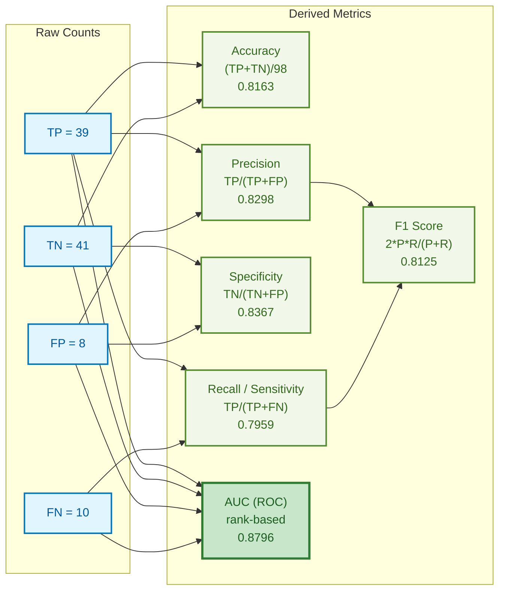
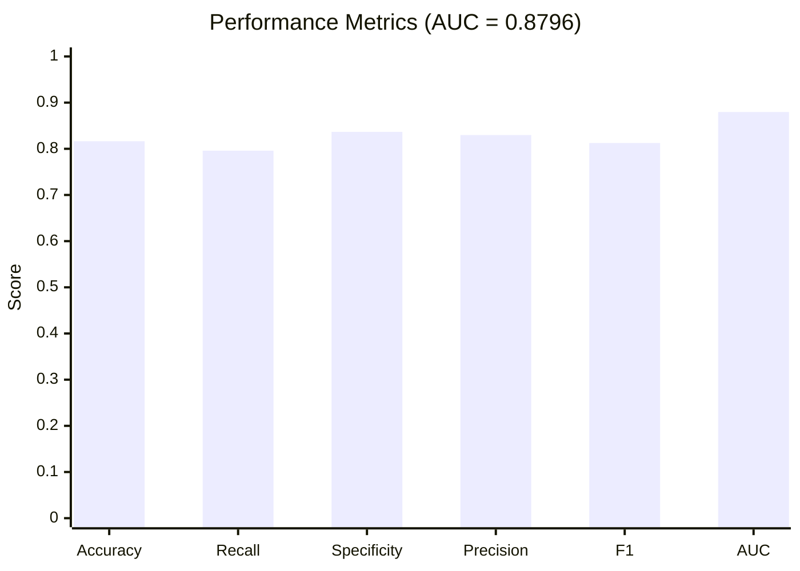
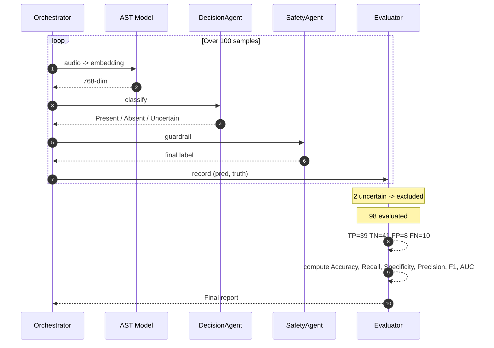
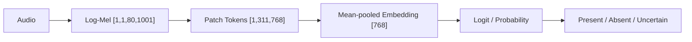
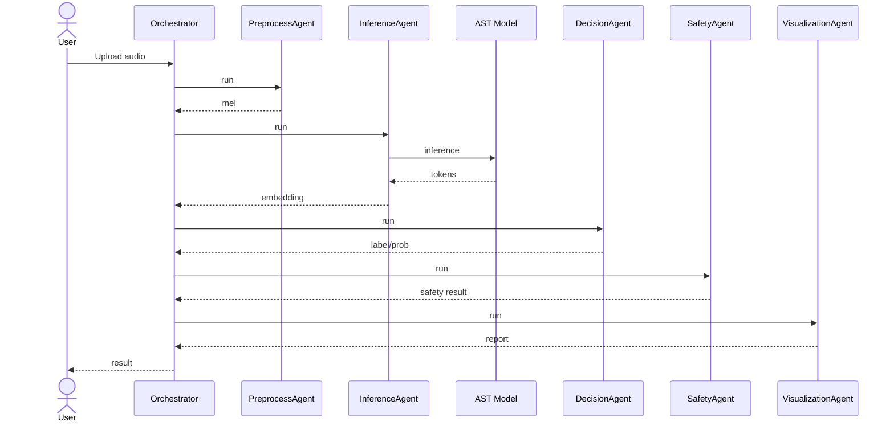
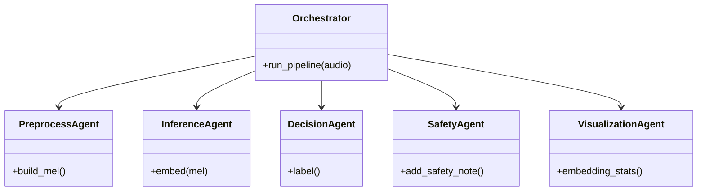

# Agentic Heart Sound Detector

A multi-agent heart sound detector using the **Eheart_sound_by_Ahsan_Mandhar.onnx** model (Audio Spectrogram Transformer, AST) with a linear probe.

## Model
- **Model file:** `Eheart_sound_by_Ahsan_Mandhar.onnx`
- **Base pretrained:** `MIT/ast-finetuned-audioset-10-10-0.4593`
- **Type:** Audio Spectrogram Transformer (AST) — ViT-style encoder
- **Dataset:** CirCor DigiScope Phonocardiogram Dataset
- **Classes:** 0=Absent, 1=Murmur, 2=Unknown
- **Precision:** INT8 (ONNX)
- **Input:** `[1, 1, 80, 1001]` log-mel spectrogram
- **Patch size:** 16×16 → 310 patches + 1 CLS token = 311 tokens
- **Hidden dimension:** 768
- **Encoder layers:** 12
- **Output:** `[1, 311, 768]` embeddings → 768-dim pooled vector
- **Classifier:** Linear probe (`probe.json`)

## Installation Guide

## Download (PC)
[Download heart-murmur-pc-v5.zip](https://github.com/ahsanmandhar-ui/heart-murmur-pwa/releases/download/pc-v5/heart-murmur-pc-v5.zip)

## Features
- Multi-agent pipeline (preprocess → inference → decision → safety → visualization)
- Local model caching
- Download progress display
- Audio analysis with waveform and mel views
- Decision-support output with abstention
- Audio conversion integrated (decode to 16 kHz mono)
## Metrics (100-sample evaluation)

### Confusion Matrix

### Outcome Distribution

### Derived Metrics

### Metrics Bar Chart

### Evaluation Flow

## Architecture Overview

### Model Pipeline Flow

### Agent Interaction Sequence

### Model + Agent System Architecture

### Agent Class Diagram

## Provenance & License
- **Base model:** MIT/ast-finetuned-audioset-10-10-0.4593 (MIT License)
- **Dataset:** CirCor DigiScope Phonocardiogram Dataset (ODC Attribution License)
- **Fine-tuning & quantization:** Ahsan Mandhar
- **License:** MIT (see LICENSE file)
- **Attribution:** Original copyright preserved; modifications copyright (c) 2026 Ahsan Mandhar
## License
All rights reserved. No permission is granted to copy, reproduce, distribute, modify, or use this software, model, or associated files without prior written permission.

## Contact
Email: ahsanmandhar@gmail.com

